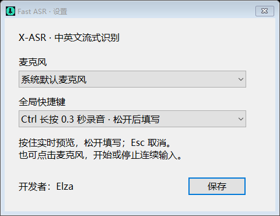

# Fast ASR

轻量 Windows 本地中英文语音输入工具，开发者 **Elza**。当前版本 **0.3.5 Preview**，仅使用 **X-ASR-zh-en INT8 480 ms**，权重约 169 MB。原生 Win32 界面，CPU 推理，不需要 Python、CUDA 或显卡。

这是个人学习、开发实验与非营利技术分享项目；原创代码采用 MIT 许可，上游模型与运行库保留各自许可。用途说明不改变上游授权。详情见 [第三方声明](THIRD_PARTY_NOTICES.md) 和 [项目说明](docs/LEGAL.md)。


## 开始使用

1. 完整解压 `FastASR-0.3.5-win-x64.zip`，双击其中的 `FastASR.exe`，等待模型就绪。
2. 点击目标输入框，单独按住左或右 **Ctrl 至少 0.3 秒**，麦克风变红后说话。
3. 按住期间在悬浮窗实时预览；松开 Ctrl 后，最终文字填入原输入框。不会按回车或发送消息。
4. 也可点击绿色麦克风开始连续输入，停顿后自动填写；再次点击红色停止按钮结束。

首次使用默认启用 Ctrl 长按，启动时麦克风仍然关闭。升级时保留已明确保存的快捷键偏好；旧用户若关闭过快捷键，可在设置中选择 Ctrl 长按。按 Esc 或在长按录音中使用 Ctrl 组合键，会取消本次尚未填写的内容。单次长按最长 60 秒；触发前不采集语音。

标题栏圆角图钉按钮切换置顶：青绿色表示已置顶，灰色表示未置顶，重启保留选择；点击不会抢走输入焦点。设置只有麦克风和快捷键选项，并标注“开发者：Elza”。



## 本版范围

只保留 X-ASR 中英文流式模型。VAD 语音检测及其参数、概率显示、Whisper 模型菜单和相关运行库均已退出本版运行与交付。音频直接送入 X-ASR，连续输入由模型自身端点检测断句，使用固定约 600 ms 尾部静音条件。实际填写还需要模型块、前瞻和推理耗时，480 ms 不是端到端延迟承诺。长按中停顿可以结束识别段，文字仍等松键统一填写。

权重文件共 169,169,147 字节，约 169 MB；权重大小不同于运行内存，实测见 [验证记录](docs/validation.md)。仅使用 CPU，不建立 GPU 推理上下文。支持 Windows 10/11 x64，软件目录需要可写。

## 文字与焦点

- 流式候选只在悬浮窗预览，确认结果才写入输入框。
- “复制”优先复制待填写文字，否则复制本次文本；复制后继续说话仍可自动填写。
- 焦点离开绑定控件时暂停填写；返回原控件后恢复。换输入框时，先点击新框，再点“填写”绑定。
- “清空”取消当前录音并清空本次文本。长文本会撑高窗口，达到上限后可用滚轮查看；复制保留完整文字。
- 不保存录音或转写历史。设置位于 `data/settings.json`；主动诊断时写入 `reports/`。

各输入软件的兼容性由用户实际验收。权限较高的应用可能拒绝模拟输入，某些网页编辑器共享原生控件句柄。旧模型配置会迁移到 X-ASR，其他偏好保留；程序不会自动清理旧版文件。

## 下载模型和构建

Git 不包含权重、运行库、下载缓存或便携包。固定版本与 SHA-256 见 `assets/xasr-manifest.json`。只下载模型需要 Python 3.9+：

```powershell
python scripts/download_models.py
python scripts/download_models.py --verify-only
# 给已解压的便携目录补齐 X-ASR 模型
python scripts/download_models.py --portable-dir "C:\Apps\FastASR"
```

模型下载会保留许可证、来源清单和项目说明；损坏或未完成文件保留以便恢复。完整便携包已含模型，无需再次下载。

从源码构建需要 Rust MSVC、Visual Studio C++ 桌面工具及 Windows SDK、Python 3.9+。X-ASR 使用固定版本预编译 CPU DLL，无需编译 Whisper：

```powershell
powershell -ExecutionPolicy Bypass -File scripts/build.ps1 -PrepareAssets
powershell -ExecutionPolicy Bypass -File scripts/verify.ps1 -IncludeUI
python scripts/package.py --require-ui
python scripts/validate_package.py
```

开发运行时设置 `FAST_ASR_HOME` 为源码根目录；便携版无需设置。诊断入口包括 `--self-test`、`--pipeline-probe`、`--hotkey-probe`、`--input-probe`、`--ui-probe`。WAV 管线不打开麦克风；交互检查只在自建测试输入框模拟输入，运行期间请保持桌面空闲。检查通过代表流程与基本输出通过，不代表 CER/WER 达标。

## 发布

请完整解压压缩包，保留 `runtime/`、`models/` 和许可证，不能只复制 exe。当前程序未签名，可用同版本 `SHA256SUMS` 校验。CI 构建、WAV 检查并校验包，桌面回归在本机执行；CI 产物为源码包与报告。完整离线包由维护者另行发布。

本版评审见 [0.3.5 发布记录](docs/release-review-0.3.5.md)。开发反馈见 [CONTRIBUTING.md](CONTRIBUTING.md)，隐私与输入保护边界见 [SECURITY.md](SECURITY.md)。
