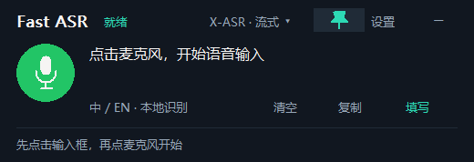

# Fast ASR 0.3.4 · Preview

> **个人学习与非营利分享**：本项目用于个人开发实验和技术交流，维护者当前不销售软件或模型，也不提供收费服务。第三方 ASR 模型来自其原作者和上游分发项目，并非本项目训练。项目为独立集成，无上游官方背书。原创代码保留 MIT 许可；该用途说明不额外禁止商用。详见 [项目用途与授权说明](docs/LEGAL.md) 和 [第三方声明](THIRD_PARTY_NOTICES.md)。

Windows 本地语音输入工具，原生轻量悬浮窗，支持中英文。Git 仓库提供源码与模型下载脚本。完整便携包包含两套模型，解压后双击 FastASR.exe 即可离线识别，无需 Python 或 CUDA；便携版 Release 另行发布。



## 使用方法

1. 完整解压便携包，双击 FastASR.exe，等待模型就绪。
2. 点击要输入文字的输入框，再点击悬浮窗左侧麦克风。
3. 默认 X-ASR 会在悬浮窗实时预览识别结果；停顿后把确认的文字自动填入目标框。再次点击麦克风会停止录音并处理最后一句。不会自动发送或按回车。
4. 点击标题栏的模型名称，或打开设置，可切换 X-ASR / Turbo Q5。切换完成后重新点击麦克风开始。

标题栏的**图钉图标**控制置顶：默认置顶，点击切换，重启后保留选择；操作不会抢走输入框焦点。麦克风按钮就绪时为绿色，录音时变为红色停止图标，处理时显示等待图标。

启动时麦克风关闭。快捷键默认关闭；设置中可选择 **Ctrl 长按 0.3 秒录音 · 松开后填写**，或 **Ctrl+Alt+空格：按一次开始/停止**。单独按住左/右 Ctrl 满 0.3 秒后开始录音，请等麦克风变红再说话。X-ASR 在按住期间持续推理并预览，最终文字暂存，松开后统一填写；Esc 或录音期间的 Ctrl 组合键取消这次未提交内容。Turbo 仍按 VAD 分段解码，不会变成流式模型。单次最长 60 秒，触发前不采集语音。旧版长按模式升级为 Ctrl 0.3 秒；切换模式仍使用 Ctrl+Alt+空格。

两种模型均接入 **Silero VAD**。设置可调整语音阈值（0.2–0.8，越低越敏感）、最短语音（64–512 ms，过滤短促杂音）和停顿时间（400 / 600 / 1000 ms）。默认 0.5 / 128 ms / 600 ms。录音时标题显示“等待语音／检测到语音”，底部显示 `VAD 当前语音概率 / 配置阈值`；该值是语音概率，不是音量或 ASR 准确率。保持语音状态时有滞回判断，不能只用单帧概率推断最终分段。

**点击和长按是两种录音入口，VAD 是共用的过滤与分段环节。** 点击麦克风后持续录音，说话预览、停顿填写；长按期间预览、松开填写。两者不会同时开两路录音。VAD 不会自行开启麦克风，不包含后台常驻的免按键监听模式。测试停顿参数时请用点击录音；长按期间的停顿不向输入框提交文字。


## 两套模型

| 模型 | 权重文件大小 | 适用方式 |
| --- | --- | --- |
| X-ASR-zh-en INT8，480 ms 流式 | 三个权重共 169,169,147 字节，约 169 MB | 默认；中英混说，实时预览，停顿后填写 |
| Whisper Large-v3-Turbo Q5_0 | 574,041,195 字节，约 574 MB | 可选对照；Silero VAD 分段后识别，CPU 处理较慢 |

480 ms 是模型流式块配置，不是从说话到输入框显示的总延迟。自动填写还取决于停顿设置和 CPU 推理时间。Whisper Turbo 本身是多语言模型，保留自动语言识别；X-ASR 是此版本面向中英场景的默认选择。Turbo 超出最初 500 MB 的文件预算，因此随完整版作为可选模型提供。

两种模型均使用 CPU，不建立 GPU 推理上下文。只驻留当前选择的识别模型；切换时先处理已录内容，再释放旧模型并加载新模型。权重大小不等于内存占用，工作集和私有提交量请分别看 docs/validation.md 与随包实测报告。需要支持 AVX2 的 Windows 10/11 x64 电脑及可写的软件目录。

## 文字与焦点

- 实时候选文字只在悬浮窗预览，确认结果才写入输入框，避免识别修改过程中反复改写目标文本。
- “复制”优先复制待填写文字，否则复制本次文本；复制后继续说话仍可自动填写。
- 焦点离开绑定控件时暂停填写；返回原控件后自动恢复。要换到新输入框，先点击新框，再点“填写”绑定。
- “清空”取消当前录音并清空本次文本。长文本会撑高窗口，达到上限后可用滚轮查看；复制保留全部文字。
- 不保存录音或识别历史。设置位于 data/settings.json；主动诊断时会写 reports/。

Windows 权限较高的程序可能拒绝模拟输入；多个网页编辑器有时共享原生控件句柄，兼容性由用户实际测试。旧 Whisper Small Q5/F16 已退出新版菜单和交付包。旧模型配置会迁移为 X-ASR，保留麦克风、快捷键和窗口位置。升级后如需清理旧模型，请先确认不再需要旧版本。

## 下载模型

模型下载会同时保留上游许可证、模型卡、来源清单和项目用途说明；不得将它们替换为本项目 MIT 许可。`python scripts/check_licenses.py` 可离线检查授权材料完整性；它不代表训练数据权利链或所有使用场景已获法律审查。

Git 仓库不包含模型权重、运行库或下载缓存。模型版本、来源、文件大小和 SHA-256 固定在 `assets/*-manifest.json` 与准备脚本中；下载完成后校验，已通过校验的文件直接复用，未完成下载可继续。

只下载模型需要 Python 3.9+，不需要 Rust、Visual Studio 或 CMake。在仓库根目录运行：

```powershell
# 默认准备 X-ASR（约 169 MB）与共享 Silero VAD（小于 1 MB）
python scripts/download_models.py
# 按需准备 Whisper Turbo（约 574 MB）与 VAD
python scripts/download_models.py --model turbo
# 下载两套模型，或只检查本地文件
python scripts/download_models.py --model all
python scripts/download_models.py --model all --verify-only
```

默认保存到 `vendor/models/`，X-ASR 压缩归档缓存到 `vendor/downloads/`，均不会进入 Git。仅下载模型不能代替编译软件；从源码运行还需要下一节的运行库准备和构建。

如需补齐已解压便携版的模型，可指定含有 `FastASR.exe` 和 `runtime/` 的应用目录：

```powershell
python scripts/download_models.py --model all --portable-dir "C:\Apps\FastASR"
```

已包含两套模型的完整版无需再下载。下载失败时保留可恢复的临时文件或损坏文件备份，不自动清理旧模型。

## 构建与验证

开发环境：Rust MSVC、Visual Studio C++、CMake、Python 3.9+。构建缓存、临时目录和产物均位于本工作区。

```powershell
powershell -ExecutionPolicy Bypass -File scripts/build.ps1 -PrepareAssets
powershell -ExecutionPolicy Bypass -File scripts/verify.ps1 -IncludeUI
python scripts/package.py --require-ui
python scripts/validate_package.py
```

开发运行时设置 FAST_ASR_HOME 为项目根目录。便携包不需要此变量。诊断参数：--self-test --model x-asr-zh-en-480ms；--self-test --model whisper-large-v3-turbo-q5_0；--pipeline-probe；--input-probe；--ui-probe。管线自检使用 WAV 按实时节奏回放，不打开麦克风。所有自检的 passed 只代表程序流程与基本输出检查通过，不代表准确率或 CER/WER 达标。


## 发布与开源

代码采用 MIT 许可证，模型和运行库保留各自上游许可证，详见 LICENSE 与 THIRD_PARTY_NOTICES.md。公开版本定位为 **Preview**：已有 WAV、输入焦点和桌面回归检查，尚未形成不同麦克风、口音和编辑器上的系统准确率数据。公开前的评审记录见 docs/release-review-0.3.1.md。

完整离线包约 682 MB，包含两套模型；无需 Python 或 CUDA。程序目前未签名，Windows 可能提示来源未知；校验文件见同版本 SHA256SUMS。不要仅拷贝 exe，需保留 runtime/ 和 models/。源码提交排除模型二进制；模型由脚本从固定上游地址获取。当前 CI 仅上传源码包与验证报告，完整离线包可在维护者发布 Release 时另行提供。

开发流程和问题反馈见 CONTRIBUTING.md；隐私与已知输入保护边界见 SECURITY.md。Windows 工作流执行构建、Rust 检查、WAV 自检和打包校验；桌面交互检查在本机单独执行。
